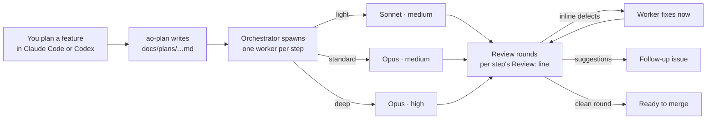

<div align="center">

# ao-skills

**Right model for each task. Right depth of review for each PR.**

Planning skills for [Orchestrator.inc](https://github.com/OrchestratorInc/agent-orchestrator) that turn a feature into a plan the orchestrator runs on its own: every step picks its worker's model and reasoning effort, and every PR gets as many review rounds as its risk deserves.

[](LICENSE)
[](#install)
[](#install)
[](https://github.com/ezpzbz/ao-skills/stargazers)

[Install](#install) · [How it works](#how-it-works) · [Example plan](examples/tasklist/docs/plans/2026-11-20-tasklist-v1.md) · [Customize tiers](#tiers)

</div>

> Community project, not affiliated with Orchestrator.inc.

## Why

Orchestrator.inc runs a fleet of coding agents, but a project has one default worker model and one default review. That leaves two costs on the table:

- **Every task gets the same model.** A README edit runs on the same model and effort as a concurrency fix. You pay for the top tier on trivial work, or under-power the risky work.
- **Review never ends.** Each review round finds something, and agents try to fix all of it in the PR. You end up deciding by hand which findings matter now and which can wait.

`ao-plan` makes both decisions at planning time, written into the plan, so the orchestrator applies them without you.

## How it works



1. **Plan as usual.** In Claude Code or Codex (plan mode works), ask for a plan "for the orchestrator". The skill splits the work into one step per PR and rates each step's risk.
2. **Each step carries its worker and review.** The plan is committed to `docs/plans/` and tells the orchestrator how to run itself, so no project setup is needed:

   ```markdown
   ## Step 4: Safe concurrent writes
   ...
   - Depends on: 3
   - Risk: high. Concurrency and data-loss bugs.
   - Tier: deep
   - Worker: `--agent claude-code --model claude-opus-5-5 --effort high`
   - Review: `standard → deep → deep`
   ```

3. **Hand it off.** Give the orchestrator one line:

   ```
   Implement docs/plans/<file>.md, following its "How to run this plan" section.
   ```

## Install

**Claude Code**

```
/plugin marketplace add ezpzbz/ao-skills
/plugin install ao-plan@ao-skills
```

**Codex** (and other agents that read `~/.agents/skills`)

```bash
git clone https://github.com/ezpzbz/ao-skills.git
cp -R ao-skills/skills/ao-plan ~/.agents/skills/
```

**Orchestrator.inc project setup**

- Register the repo: `ao project add --path <repo>`.
- Turn off **automatic review** (`autoReview`) in the project's settings, so Orchestrator.inc does not start its own reviews alongside the plan's rounds.

## Tiers

| Tier | Used for | Default worker | Default review rounds |
|------|----------|----------------|-----------------------|
| light | docs, config, mechanical one-file changes | Sonnet 5.5 · medium | standard |
| standard | normal features and fixes | Opus 5.5 · medium | standard → deep |
| deep | concurrency, data loss, migrations, security, unclear bugs | Opus 5.5 · high | standard → deep → deep |

Tiers can use any agent `ao spawn --agent` supports. To change them, add an `## AO worker tiers` table to `~/.claude/CLAUDE.md`, `~/.codex/AGENTS.md`, or a repo's `CLAUDE.md` / `AGENTS.md`; a repo table wins. For example, Codex for light work and Claude Code for the rest:

```markdown
## AO worker tiers

| Tier | Worker flags |
|------|--------------|
| light | `--agent codex --model gpt-5.6-sol --effort low` |
| standard | `--agent claude-code --model claude-opus-5-5 --effort medium` |
| deep | `--agent claude-code --model claude-opus-5-5 --effort high` |
```

Details: [skills/ao-plan/references/tiers.md](skills/ao-plan/references/tiers.md).

## Review rounds

For each round in a step's `Review:` line, the orchestrator posts the reviewer's agent, model and effort as a PR comment, then runs `ao review trigger` with that tier's flags.

- **Inline comments** are the reviewer's verified defects. The worker fixes them in the PR.
- **Optional suggestions** from the review summary go into one `Follow-ups from PR #N` issue per PR (label `review-followup`), instead of growing the PR.
- **A clean round ends review** for that step. If the last round still finds defects, one more round runs; if that one does too, the orchestrator asks you.

Workers put their agent, model and effort at the top of the PR description, so every PR shows who wrote it and who reviewed it. On deep steps, workers run a local review (such as `/code-review`) before opening the PR.

## Works with your planning flow

- **superpowers:** if `writing-plans` is shaping the plan, it writes the steps and `ao-plan` adds the Orchestrator.inc sections to the same file. One plan, not two.
- **New or existing repos:** the skill reads `CLAUDE.md`, `AGENTS.md` and the README for conventions and the test command before splitting work.

## Try it

[examples/tasklist](examples/tasklist) is a tiny Python CLI with a ready plan that uses all three tiers, including a real concurrency bug for the deep tier.

```bash
cp -R examples/tasklist ~/tmp/tasklist && cd ~/tmp/tasklist
git init -b main && git add . && git commit -m "initial"
gh repo create tasklist-ao-test --private --source . --push
ao project add --path "$PWD" --id tasklist
```

Then tell the project's orchestrator: `Implement docs/plans/2026-11-20-tasklist-v1.md, following its "How to run this plan" section.`

## Limits

- The plan is instructions, not enforcement. Orchestrator.inc does not validate `Worker:` or `Review:` lines; an orchestrator that skips one falls back to project defaults.
- Orchestrator.inc's reviewer decides what is an inline defect and what is a suggestion. A minor real defect it posts inline gets fixed in the PR rather than deferred.

## Contributing

Issues and PRs are welcome, especially tier tables that work well for other agents and reports from real runs. See [CONTRIBUTING.md](CONTRIBUTING.md).

## License

[MIT](LICENSE)
